<div align="center">


# ClawdyCalc

**Ever wondered what your Claude Code habit would cost if you paid API prices?**<br>
Me too. So I built a tiny dashboard where little pixel Clawds bounce around while you find out.


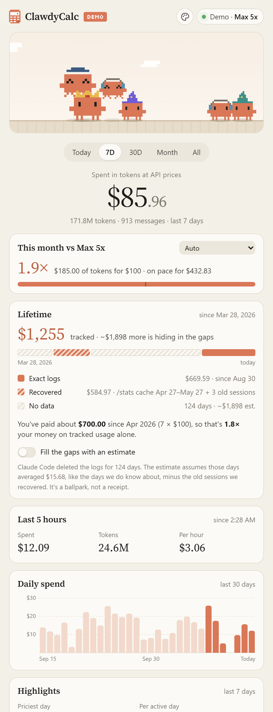&nbsp;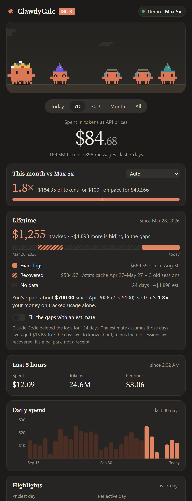

<sub>(That's demo data. Nobody's real bill is being exposed here, relax.)</sub>

</div>

---

## So what is this?

I'm on a Claude subscription. Flat monthly price, use it as much as you want. Great deal, probably.

But *how* great? Claude Code quietly writes down every token you burn, so I wanted to see the number. Not the plan price. The "if Anthropic sent me an itemized bill at API rates" number.

ClawdyCalc reads those logs, prices every message, and shows you:

- **What you've spent** today, this week, this month and all time, at API list prices
- **How much value you get from your plan.** "You paid $100 and got $412 worth of tokens" hits different
- **Your last 5 hours**, which is the window your usage limits are counted in, plus your burn rate per hour
- **Lifetime spend, including history Claude Code already deleted** (more on that [below](#wait-where-did-my-old-usage-go))
- **Which models ate your budget**, and whether it went to output, cache writes or cache reads
- **Your most expensive projects**, so you know who to blame
- **Fun stats**, like your priciest day and how much prompt caching saved you (spoiler: a lot)
- **CSV export**, for spreadsheet people
- **Themes for people who live in their editor**: Terminal, Dracula, Tokyo Night, Catppuccin, Gruvbox, Nord, Synthwave, and a Sakura one where everyone turns samurai

And the important part: **every model you've used shows up as a little Clawd.** They walk around, hop, do backflips, and high-five when they bump into each other. Click one to see what it cost you. Grab one and throw it across the screen. When you spend new tokens, that model jumps and drops a coin.

## Meet the cast

| | Who | Wears | Vibe |
|:-:|---|---|---|
|  | **Fable** | wizard hat | the big brain, priced like it |
|  | **Mythos** | crimson wizard hat | secret-club wizard |
|  | **Opus 5.5** | crown | the current king |
|  | **Opus 5** | grad cap | graduated, still shows up to work |
|  | **Opus 4.x** | beanie | the OG |
|  | **Sonnet** | headphones | just vibing and shipping |
|  | **Haiku** | sprout | small but mighty |
|  | **Anything new** | party hat | welcome to the party |

The more you spend on a model, the bigger its Clawd gets. Chonk reflects spend.

|  | In the **Sakura** theme, every Clawd trades its hat for a kabuto in its model's color and picks up a katana. Samurai don't high-five. They bow to each other, and every now and then they slash at nothing in particular. Click one and it'll show you. |
|:-:|---|

## Themes

Click the palette in the top right, or just press <kbd>T</kbd> to flip through them. The code-editor themes switch everything to JetBrains Mono, because of course they do.

<table>
  <tr>
    <td align="center">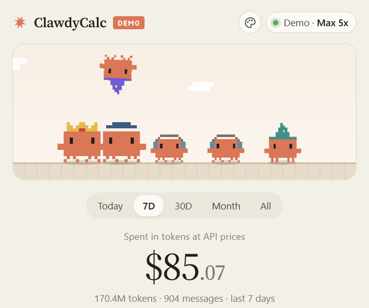<br><sub><b>Claude</b> · follows your system</sub></td>
    <td align="center">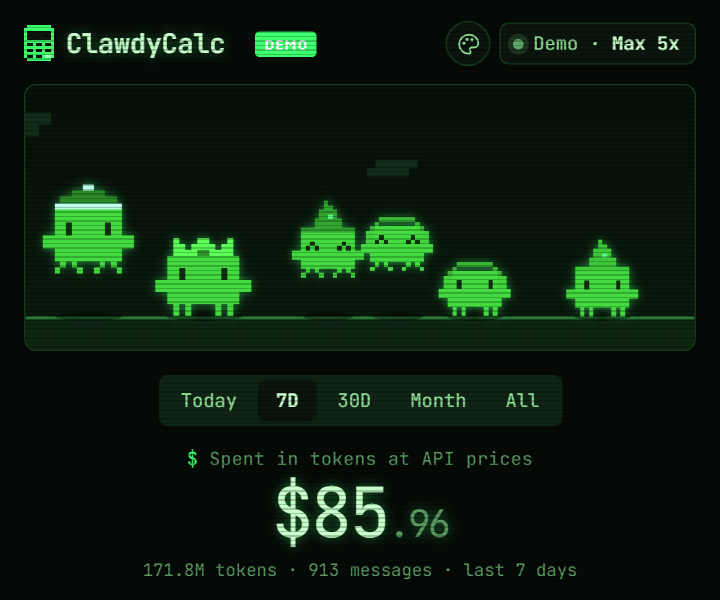<br><sub><b>Terminal</b> · green phosphor CRT</sub></td>
    <td align="center">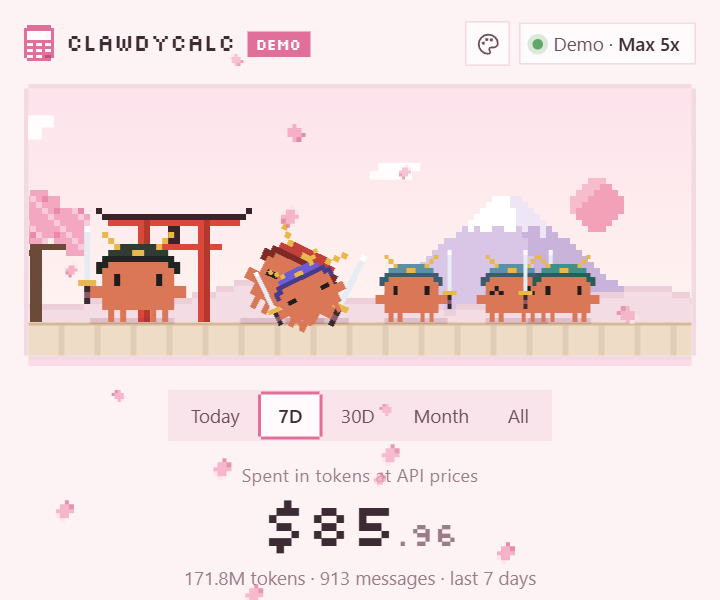<br><sub><b>Sakura</b> · pixel art, petals and samurai</sub></td>
  </tr>
  <tr>
    <td align="center">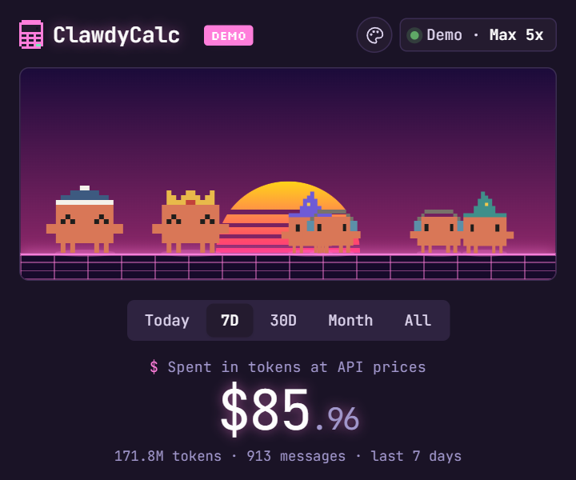<br><sub><b>Synthwave</b> · '84 neon sunset</sub></td>
    <td align="center">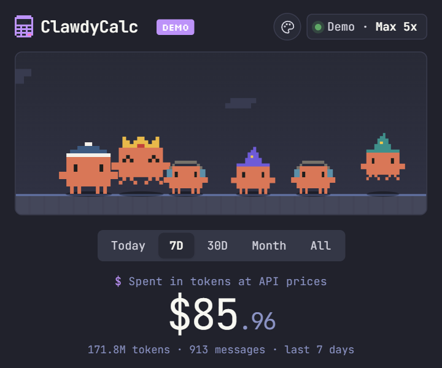<br><sub><b>Dracula</b></sub></td>
    <td align="center">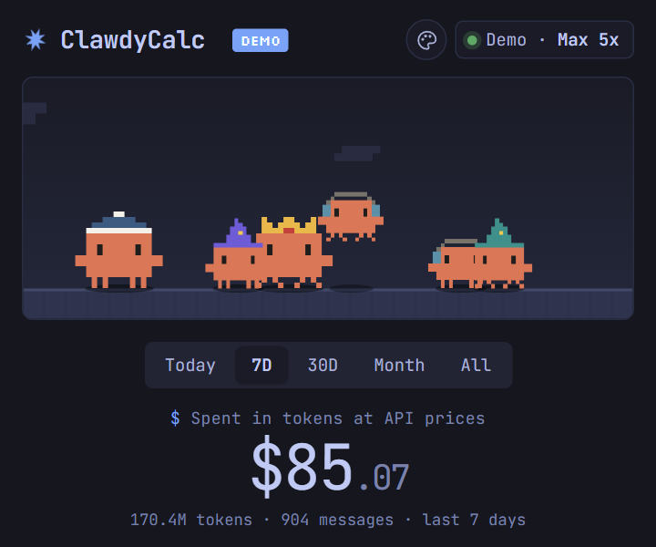<br><sub><b>Tokyo Night</b></sub></td>
  </tr>
  <tr>
    <td align="center">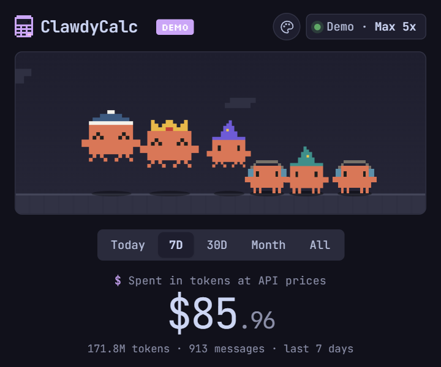<br><sub><b>Catppuccin</b> · mocha</sub></td>
    <td align="center">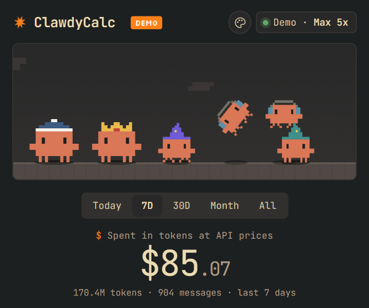<br><sub><b>Gruvbox</b></sub></td>
    <td align="center">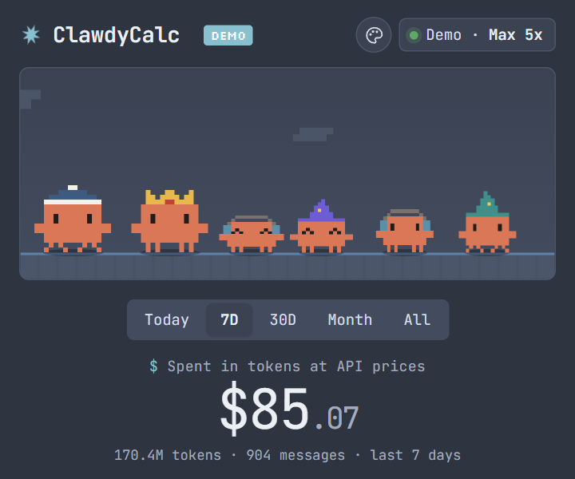<br><sub><b>Nord</b></sub></td>
  </tr>
</table>

| Key | Does |
|---|---|
| <kbd>T</kbd> / <kbd>Shift</kbd>+<kbd>T</kbd> | next / previous theme |
| <kbd>1</kbd> to <kbd>5</kbd> | Today, 7D, 30D, Month, All |
| <kbd>R</kbd> | refresh now |
| <kbd>Esc</kbd> | close the theme picker |
| <kbd>P</kbd> | pin on top (desktop app) |
| <kbd>C</kbd> | compact mode (desktop app) |
| <kbd>Ctrl</kbd>+<kbd>Alt</kbd>+<kbd>Shift</kbd>+<kbd>C</kbd> | show or hide ClawdyCalc from anywhere (desktop app) |

Want your favorite editor theme in here? A theme is about 15 CSS variables in [`public/css/themes.css`](public/css/themes.css) plus one line in [`public/js/themes.js`](public/js/themes.js). PRs welcome.

## Get it running

You need [Node.js](https://nodejs.org) 18 or newer. There are two ways to run it.

### The desktop app (recommended)

A real Windows app with its own window, taskbar icon and tray icon.

```bash
git clone https://github.com/TedoNeObichaJavaScript/ClawdyCalc.git
cd ClawdyCalc
npm install
npm run app
```

To get a proper installer (Start menu and desktop shortcuts, uninstaller) plus a portable `.exe`, run `npm run dist` and look in `dist/`. The builds aren't code-signed, so the first time Windows SmartScreen will say "Windows protected your PC". Click **More info**, then **Run anyway**.

What the desktop app adds:

- **Pin on top.** Hit the pin and ClawdyCalc floats above everything, like a little widget.
- **Compact mode.** Shrinks the window to just the Clawds and today's number. Pinned + compact is the best way to keep an eye on your burn rate.
- **Lives in the tray.** Closing the window hides it, so it keeps archiving your usage in the background. The tray tooltip shows today's and this month's spend. Right-click the tray icon to quit.
- **Start with Windows**, **window opacity** and **pin/compact** live in the tray menu.
- **Remembers** where you left the window, how big it was, and whether it was pinned.
- **Global hotkey** <kbd>Ctrl</kbd>+<kbd>Alt</kbd>+<kbd>Shift</kbd>+<kbd>C</kbd> to pop it up from anywhere.

### The browser version (zero dependencies)

No `npm install` needed at all.

```bash
git clone https://github.com/TedoNeObichaJavaScript/ClawdyCalc.git
cd ClawdyCalc
npm start
```

It starts a little server at `http://localhost:4317` and opens it in a small browser window. On Windows you can also double-click **`ClawdyCalc.bat`**, which opens the desktop app if you've run `npm install`, and the browser version if you haven't.

Want to see it without your own data? Open `http://localhost:4317/?demo`.

<details>
<summary>More options</summary>

```bash
node bin/clawdycalc.js --port 5000   # different port
node bin/clawdycalc.js --no-open     # don't open a window, just serve
```

| Environment variable | What it does |
|---|---|
| `PORT` | Same as `--port` |
| `CLAUDE_CONFIG_DIR` | Where your Claude Code config lives, if you moved it |
| `CLAWDYCALC_HOME` | Where ClawdyCalc keeps its archive (default `~/.clawdycalc`) |

> [!TIP]
> Running `npm run app` from a terminal inside VS Code? VS Code sets `ELECTRON_RUN_AS_NODE`, which stops Electron apps from opening a window. The `app` script clears it for you, but if you launch Electron some other way, unset it first.

</details>

## Wait, where did my old usage go?

Here's the thing nobody tells you: **Claude Code deletes your session logs after 30 days.** That's the default `cleanupPeriodDays` setting. So if you've been using it for a year, your logs only remember the last month, and any usage tracker will tell you that you've barely spent anything.

I found out the hard way. My first version said I'd spent about $400 total. I knew that was nonsense.

So ClawdyCalc goes digging:

1. **Session logs** (`~/.claude/projects`). Exact, message by message, but only the last 30 days.
2. **The `/stats` cache** (`~/.claude/stats-cache.json`). If you ever ran `/stats`, Claude Code saved exact per-model token totals for that window. Old data, recovered.
3. **Last-session totals** (`~/.claude.json`). Claude Code remembers the token usage of the last session in every project, even after the log is gone.
4. **Its own archive** (`~/.clawdycalc`). While ClawdyCalc is running, it copies every message it sees, so once it's tracked something, the data can't disappear on you.

For days where truly nothing survived, you can flip on **"Fill the gaps with an estimate"**. It uses your average daily spend from the days it does know about. It's clearly marked as an estimate, because it is one.

And to stop the bleeding, there's a **Keep logs forever** button that sets `cleanupPeriodDays` to 100 years. It backs up your settings file first. Or do it yourself in `~/.claude/settings.json`:

```json
{ "cleanupPeriodDays": 36500 }
```

## How the math works

Every message in the logs says which model answered and how many tokens went where. ClawdyCalc multiplies those by [Anthropic's API list prices](src/pricing.js):

- **Input** and **output** at each model's own rate
- **Cache writes** at 1.25× the input rate (5-minute cache) or 2× (1-hour cache)
- **Cache reads** at each model's cache-read rate (it's not the same multiplier for every model)
- **Fast mode** at 2×

Claude Code logs one line per chunk of a response, all with the same message ID, so ClawdyCalc dedupes by ID. Otherwise you'd count the same tokens three or four times and feel very rich in the wrong way.

> [!NOTE]
> These are estimates at list prices, not a bill. If you're on a subscription, you pay your plan price no matter what this says. Only Claude Code on this machine is counted. Chats on claude.ai don't write these logs.

## Is my data going anywhere?

Nope. The server listens on `127.0.0.1` only, has no telemetry, and never makes a network request except for loading the Google Fonts the page uses. It reads your files, does math, and shows you a page. That's all.

The desktop app is the same thing in its own window. The page inside it can't touch your files or Node. It can only ask the app to pin, resize or hide the window.

## Project layout

```
ClawdyCalc/
├── bin/clawdycalc.js        the CLI you run
├── desktop/                 the Electron app: main.js (window, tray, pin), preload.js, icons/
├── src/
│   ├── server.js            tiny HTTP server + API
│   ├── sources/             where the numbers come from
│   │   ├── logs.js            session logs (exact)
│   │   ├── stats-cache.js     the /stats cache (recovered)
│   │   └── last-sessions.js   ~/.claude.json totals (recovered)
│   ├── ledger.js            ClawdyCalc's own archive
│   ├── report.js            merges everything, works out gaps + estimates
│   ├── pricing.js           the price list
│   └── demo.js              fake data for ?demo
├── public/                  the page (plain HTML/CSS/JS, no build step)
│   ├── css/                 style.css + themes.css
│   ├── img/                 theme backdrops (Mt. Fuji lives here)
│   └── js/                  app.js, stage.js (the playground), sprites.js (the Clawds),
│                            themes.js (theme picker, petals, samurai mode)
├── scripts/                 build-readme-art.js, build-theme-art.js, build-icons.js (all the pixel art),
│                            launch-app.js (npm run app)
└── docs/                    README images and theme previews
```

## Contributing

PRs are very welcome. Some ideas if you're looking for one:

- More themes! Solarized, One Dark, Rosé Pine, your call.
- More hats! Every model deserves a look. Hats live in `public/js/sprites.js` as tiny pixel grids.
- macOS and Linux builds of the desktop app (the config is there, it just needs testing)
- Testing on macOS and Linux (I built it on Windows)
- More charts, like spend by hour of day

When a new model comes out, add it to `src/pricing.js` and give it a hat. If you change the sprites, run `npm run art` to regenerate the README art.

One rule: **the browser version stays dependency-free.** Electron is only for the desktop wrapper, and everything in `src/` and `public/` has to keep working with plain Node.

## Credits

ClawdyCalc stands on a lot of other people's work. Here's everything it uses, and where each piece came from.

### Where the information comes from

| What | Source |
|---|---|
| Per-model API prices and cache-read rates | [Claude API pricing](https://platform.claude.com/docs/en/about-claude/pricing), Anthropic |
| Cache write cost (1.25× for 5 minutes, 2× for 1 hour) | [Prompt caching docs](https://platform.claude.com/docs/en/build-with-claude/prompt-caching), Anthropic |
| Fast mode pricing | [Fast mode docs](https://platform.claude.com/docs/en/build-with-claude/fast-mode), Anthropic |
| Logs getting deleted after 30 days, and `cleanupPeriodDays` | [The .claude directory](https://code.claude.com/docs/en/claude-directory) and the [settings reference](https://code.claude.com/docs/en/settings-reference#cleanupperioddays), Claude Code docs |
| The log format, `stats-cache.json` and the per-project totals in `~/.claude.json` | As far as I know these aren't publicly documented. I worked them out by reading my own local files, so they might change between Claude Code versions. |
| The idea of pricing Claude Code's local logs at all | [ccusage](https://github.com/ccusage/ccusage) by ryoppippi (MIT), which made this popular. ClawdyCalc doesn't use any of its code, but it deserves the shout-out. |

### Characters and art

- **Clawd** is Anthropic's Claude Code mascot. The pixel Clawds here are fan art drawn for this project. The hats, samurai gear, Sakura backdrop and calculator logo are all original.

### Theme palettes

Colors are adapted from these open-source themes, all MIT licensed. Go star them.

- **Dracula** by Zeno Rocha and contributors: [draculatheme.com](https://draculatheme.com)
- **Tokyo Night** by enkia: [tokyo-night-vscode-theme](https://github.com/tokyo-night/tokyo-night-vscode-theme)
- **Catppuccin** (Mocha) by the Catppuccin org: [catppuccin.com](https://catppuccin.com)
- **Gruvbox** by Pavel Pertsev (morhetz): [morhetz/gruvbox](https://github.com/morhetz/gruvbox)
- **Nord** by Sven Greb (Arctic Ice Studio): [nordtheme.com](https://www.nordtheme.com)
- **Synthwave '84** by Robb Owen: [synthwave-vscode](https://github.com/robb0wen/synthwave-vscode)

The Claude, Terminal and Sakura palettes were made for ClawdyCalc.

### Fonts

All three are under the [SIL Open Font License](https://openfontlicense.org) and load from [Google Fonts](https://fonts.google.com).

- **JetBrains Mono** by JetBrains: [jetbrains.com/mono](https://www.jetbrains.com/lp/mono/)
- **Source Serif 4** by Frank Grießhammer for Adobe: [adobe-fonts/source-serif](https://github.com/adobe-fonts/source-serif)
- **Silkscreen** by Jason Kottke: [Google Fonts](https://fonts.google.com/specimen/Silkscreen)

### Code and tools

- The demo data uses the **mulberry32** random number generator by Tommy Ettinger (public domain): [gist](https://gist.github.com/tommyettinger/46a874533244883189143505d203312c)
- README badges by [shields.io](https://shields.io)
- The desktop app is built with [Electron](https://www.electronjs.org) and packaged with [electron-builder](https://www.electron.build) (both MIT)
- README screenshots were taken with [Playwright](https://playwright.dev). It's only used for that, so it isn't a dependency.

## License

[MIT](LICENSE). Do whatever you want, just don't blame me for what the number says.

<br>

<div align="center">
<sub>ClawdyCalc is an unofficial fan project. It isn't affiliated with or endorsed by Anthropic. Claude and Clawd belong to Anthropic. I just think they're neat.</sub>
</div>
